<!-- Header wave -->
<p align="center">
  
</p>

<p align="center">
  <a href="https://git.io/typing-svg">
    
  </a>
</p>

<p align="center">
  
  <a href="https://github.com/Itthiago034?tab=followers"></a>
  <a href="https://github.com/Itthiago034/mcp-crunchyroll/stargazers"></a>
</p>

<p align="center">
  
</p>

## ⚡ About me

```rust
struct Thiago {
    loves:     ["Rust", "Linux", "the terminal", "bare metal"],
    building:  "mcp-crunchyroll — a Crunchyroll MCP server for AI agents",
    exploring: ["embedded systems", "MCP servers", "local LLMs", "AI agents"],
    languages: ["English", "Português (BR) 🇧🇷"],
    motto:     "If it can run in a terminal, it should.",
}
```

- 🔭 Currently shipping **[mcp-crunchyroll](https://github.com/Itthiago034/mcp-crunchyroll)**: letting AI agents browse anime and manage a Crunchyroll account.
- 🦀 Building **fast, keyboard-driven tools** in Rust that live in the terminal.
- 🌱 Diving deeper into **embedded Rust**, microcontrollers and the parts of a computer most people never touch.
- 🤖 Experimenting with **AI agents**, **MCP servers** and running **LLMs locally**.
- 🇧🇷 *Também documento e mantenho projetos em PT-BR quando isso ajuda a comunidade.*
- 💬 Ask me about Rust, Ratatui, Linux setups or anything low-level — I love that stuff.

---

## 🍥 Featured project — [mcp-crunchyroll](https://github.com/Itthiago034/mcp-crunchyroll)

<p align="center">
  <a href="https://github.com/Itthiago034/mcp-crunchyroll">
    
  </a>
</p>

<p align="center">
  <a href="https://github.com/Itthiago034/mcp-crunchyroll/actions/workflows/ci.yml"></a>
  
  
  
  
  
</p>

> **Let your AI agent browse anime for you.** An unofficial [Model Context Protocol](https://modelcontextprotocol.io/) server for Crunchyroll, in TypeScript: search the catalog, check your watchlist and history, and update your account straight from any MCP client. 🚀

<table>
  <tr>
    <td width="50%" valign="top">

**✨ What it does**

- 🔎 **Catalog discovery**: search, browse, categories, simulcast seasons
- 📺 Series, seasons & episode details
- 💡 Personalized **recommendations** & similar titles
- 📜 Read your **watchlist**, **history** & playheads
- ➕ Add/remove watchlist items & update playheads

</td>
    <td width="50%" valign="top">

**🔐 Security first**

- 🌐 Sign-in happens only in a **managed browser**, so passwords and tokens never show up as tool arguments
- 🪪 Account identity is **auth-derived**; callers can't pick an `accountId`
- 🧱 Closed tool schemas: unknown arguments are rejected
- 🛑 Uncertain writes **fail closed**, with no blind retries

</td>
  </tr>
</table>

<p align="center">
  
  
  
</p>

```text
MCP client ──stdio──▶ mcp-crunchyroll ──CDP──▶ managed browser ──▶ Crunchyroll
```

<p align="center">
  <a href="https://github.com/Itthiago034/mcp-crunchyroll"></a>
  <a href="https://github.com/Itthiago034/mcp-crunchyroll#install-and-build"></a>
</p>

<sub>Unofficial community project. Not affiliated with or endorsed by Crunchyroll, LLC.</sub>

---

## 🚀 What I'm into

<table>
  <tr>
    <td width="50%" valign="top">

### 🦀 Rust & the terminal
TUIs with **Ratatui**, CLIs that feel instant, and workflows where your hands never leave the keyboard.

</td>
    <td width="50%" valign="top">

### ⚙️ Embedded & low-level
Microcontrollers, memory, registers and everything that happens **close to the metal**.

</td>
  </tr>
  <tr>
    <td width="50%" valign="top">

### 🐧 Linux, always
Linux-first setups, shell scripting and dotfiles tuned for **speed and simplicity**.

</td>
    <td width="50%" valign="top">

### 🤖 AI agents & local LLMs
**MCP servers**, agent tooling and running models **on my own machine**.

</td>
  </tr>
</table>

---

## 🧰 Toolbox

<p align="center">
  <a href="https://skillicons.dev">
    
  </a>
</p>

<p align="center">
  
  
  
  
  
</p>

---

## 📈 GitHub stats

<p align="center">
  
  
</p>

<p align="center">
  
</p>

<p align="center">
  
</p>

<!-- Snake: generated by .github/workflows/snake.yml into the `output` branch -->
<p align="center">
  <picture>
    <source media="(prefers-color-scheme: dark)" srcset="https://raw.githubusercontent.com/Itthiago034/Itthiago034/output/github-snake-dark.svg" />
    <source media="(prefers-color-scheme: light)" srcset="https://raw.githubusercontent.com/Itthiago034/Itthiago034/output/github-snake.svg" />
    
  </picture>
</p>

---

<p align="center">
  <em>Older experiments may be archived — active work always comes first. 🔥</em>
</p>

<p align="center">
  
</p>
